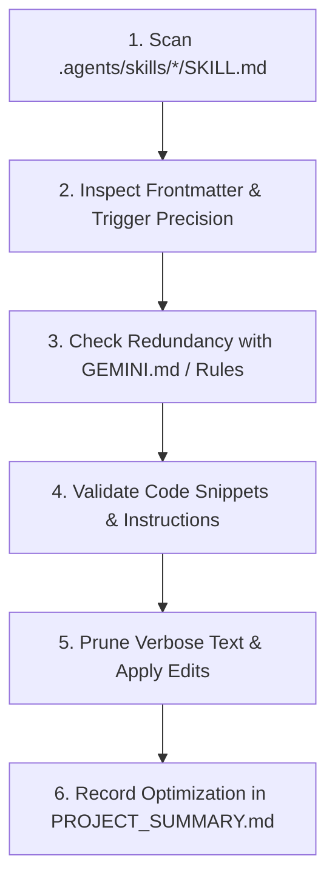

# Skill Optimizer Specification

Use this skill periodically or after major architectural milestones to inspect, prune, and enhance all project skills.

---

## 1. Optimization Objectives

1. **Token Efficiency**:
   * Descriptions in frontmatter are loaded into the agent prompt context. Keep them under 30–40 words while retaining all trigger keywords.
   * Remove filler paragraphs and conversational prose inside `SKILL.md`. Prefer concise bullet lists, tables, and short code blocks.

2. **Elimination of Overlap**:
   * Ensure two skills do not define conflicting or duplicate directives.
   * Merge closely related micro-skills into a single comprehensive skill if they are always used together.

3. **Accuracy & Deprecation Checks**:
   * Verify that pin numbers, library versions, and API signatures match the current codebase.
   * Update obsolete instructions when frameworks or project structures change.

---

## 2. Audit Workflow

---

## 3. Optimization Scorecard

When evaluating a skill, score against these criteria:
* **Trigger Accuracy**: Does the description unambiguously convey when the agent should read this skill?
* **Actionability**: Are the steps direct commands rather than theoretical commentary?
* **Conciseness**: Can any section be converted into a table or checklist without losing clarity?
* **Formatting**: Are GitHub alerts (`[!NOTE]`, `[!CAUTION]`) used strategically rather than repeatedly?

