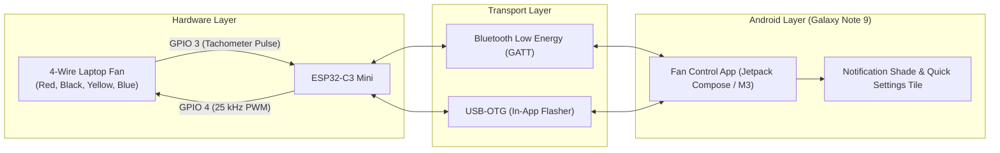

# ESP32-C3 4-Wire Fan Control & Android Companion App

A modern, high-precision cooling control system featuring an **ESP32-C3 Mini** firmware engine and a minimalist **Google Material 3 Android App** with real-time BLE telemetry, NVS state persistence, and a native **In-App USB-OTG Firmware Flasher**.

* **Official GitHub Release**: [**`v1.0.0 Release Page`**](https://github.com/roufsweb/esp-fan-control/releases/tag/v1.0.0)
* **Direct APK Download**: [**`app-debug.apk` (v1.0.0, 18.6 MB)**](https://github.com/roufsweb/esp-fan-control/releases/download/v1.0.0/app-debug.apk)
* **Unified Firmware Image**: [**`firmware_merged.bin` (offset `0x0`, 872 KB)**](https://github.com/roufsweb/esp-fan-control/releases/download/v1.0.0/firmware_merged.bin)
* **Online Web Portal & Flasher**: [**https://esp-fan-control.roufsweb.com/**](https://esp-fan-control.roufsweb.com/)

---

## 1. System Architecture Overview

---

## 2. Hardware Wiring & Pin Mapping

Standard Intel 4-wire PWM cooling fan specification:

| Wire Color | Function | ESP32-C3 Connection | Electrical Configuration |
| :--- | :--- | :--- | :--- |
| **Blue** | PWM Control | **GPIO 4** | Configured to **25 kHz** via hardware LEDC timer. Eliminates acoustic coil whine. |
| **Yellow** | Tachometer Sense | **GPIO 3** | Open-collector pulse output (2 pulses/rev). ESP32 `INPUT_PULLUP` enabled; debounced ISR. |
| **Red** | Power ($V_{cc}$) | +5V / +12V Rail | Dedicated external power supply; shares common GND with ESP32. |
| **Black** | Ground (GND) | GND | Common reference ground. |

---

## 3. Key Features & Highlights

* **Instant-Connect Bluetooth LE**: Sub-300ms connection without modal pairing prompts (`WRITE_TYPE_NO_RESPONSE` and unacknowledged `NOTIFY` streaming).
* **25 kHz High-Frequency PWM**: Adheres strictly to Intel specifications ($21\text{–}28\text{ kHz}$) to eliminate motor humming and coil noise.
* **Closed-Loop Tachometer**: Real-time RPM measurement calculated via debounced pulse intervals: $\text{RPM} = \frac{\text{Pulses}}{2} \times \frac{60}{\Delta t}$.
* **Reboot & Power-Cycle Persistence**: Retains speed, power state, and mode inside ESP32 NVS flash storage with a 1.5-second debounce wear-leveling filter.
* **Native In-App USB-OTG Flasher**: End-users without a PC can flash the ESP32-C3 Mini directly from the phone using a USB-C OTG cable and a single button tap in the app.
* **Google Material 3 Minimal Design**: High corner radius (16–28dp pill shapes), subtle pastel tonal palettes, zero emojis (pure Material Vector Drawables), and concise microcopy.
* **Control Center & Notification Controls**: Background foreground notification with live RPM and direct action toggles (`[Power]`, `[Silent]`, `[Balanced]`, `[Boost]`), plus a Quick Settings tile.

---

## 4. Repository Index & Documentation Navigation

| Document | Purpose |
| :--- | :--- |
| [**`PROJECT_INDEX.md`**](file:///e:/rouf/android-apk/esp%20fan%20controll/PROJECT_INDEX.md) | Complete directory and file catalog tracking every file path and technical role. |
| [**`PROJECT_SUMMARY.md`**](file:///e:/rouf/android-apk/esp%20fan%20controll/PROJECT_SUMMARY.md) | Cumulative changelog and experiment ledger documenting everything attempted, verified, and standardized. |
| [**`FEATURES.md`**](file:///e:/rouf/android-apk/esp%20fan%20controll/FEATURES.md) | Comprehensive feature matrix and interactive testing/verification checklist. |
| [**`AGENTS.md`**](file:///e:/rouf/android-apk/esp%20fan%20controll/AGENTS.md) | Specialized agent roles and cross-agent collaborative protocols. |
| [**`GEMINI.md`**](file:///e:/rouf/android-apk/esp%20fan%20controll/GEMINI.md) | Workspace-wide rules, hardware constraints, zero-emoji rules, and design guidelines. |

---

## 5. Specialized Antigravity Skills

Located under `.agents/skills/`:
* [**`android-ui-ux-design`**](file:///e:/rouf/android-apk/esp%20fan%20controll/.agents/skills/android-ui-ux-design/SKILL.md): Enforces Google M3 styling, rounded shapes, viewing-angle contrast, zero emojis, and concise microcopy.
* [**`sensitive-info-guard`**](file:///e:/rouf/android-apk/esp%20fan%20controll/.agents/skills/sensitive-info-guard/SKILL.md): Audits and prevents credentials, Wi-Fi passwords, private keys, keystores, and user paths from being exposed publicly.
* [**`skill-creator`**](file:///e:/rouf/android-apk/esp%20fan%20controll/.agents/skills/skill-creator/SKILL.md): Standardizes dynamic creation of new project skills on demand.
* [**`skill-optimizer`**](file:///e:/rouf/android-apk/esp%20fan%20controll/.agents/skills/skill-optimizer/SKILL.md): Audits, prunes, and consolidates skills for token efficiency and operational clarity.
* [**`project-summary-manager`**](file:///e:/rouf/android-apk/esp%20fan%20controll/.agents/skills/project-summary-manager/SKILL.md): Maintains structured summaries of trials, successes, and hardware calibrations in `PROJECT_SUMMARY.md`.

---

## 6. Pre-Compiled Artifacts

* **Android APK**: [`android/app/build/outputs/apk/debug/app-debug.apk`](file:///e:/rouf/android-apk/esp%20fan%20controll/android/app/build/outputs/apk/debug/app-debug.apk) *(19.5 MB)*
* **Unified Firmware**: [`firmware/firmware_merged.bin`](file:///e:/rouf/android-apk/esp%20fan%20controll/firmware/firmware_merged.bin) *(872 KB, flash offset `0x0`)*

---

## 7. Safety & Operating Guidelines

1. **Stall Prevention**: Active fan speed is strictly clamped to a minimum of 20% to prevent motor stall and heat buildup.
2. **Flash Endurance**: High-frequency slider scrubbing is debounced by 1.5 seconds before committing to NVS flash memory.
3. **Power Isolation**: Never attempt to power a 12V fan from the ESP32-C3 3.3V power pin. Use a dedicated power supply sharing common ground.

